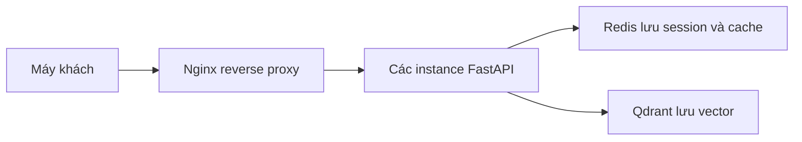

# Bài lab Ngày 14 — Trả lời nhiệm vụ

**Trạng thái:** Đã hoàn thành phần lập trình, kiểm tra Docker, benchmark tại máy,
giám sát, so sánh khả năng mở rộng với số instance đã xác minh và triển khai public
trên Railway. Ảnh `screenshots/dashboard.png` đã có, thể hiện agent và Redis đều
Online trong môi trường production. Học viên cần đọc lại và tự giải thích được các câu
trả lời, đoạn mã và số đo. Trợ lý chưa tạo commit hoặc push.

## Phần 1: Localhost và Production

### Bài 1.1: Các cách làm chưa phù hợp

Trong `01-localhost-vs-production/develop/app.py` có các vấn đề:

1. Ghi cứng `OPENAI_API_KEY` và `DATABASE_URL`. Người có quyền xem mã nguồn hoặc
   lịch sử Git có thể đọc được bí mật đã lưu trong đó.
2. In API key ra log. Thông tin xác thực có thể bị lộ ngay cả khi kho mã được giữ kín.
3. Bật `DEBUG=True` và `reload=True`, phù hợp lúc phát triển nhưng không phải cấu
   hình mặc định thích hợp cho một tiến trình triển khai ổn định.
4. Chỉ bind vào `localhost`, khiến ứng dụng trong container không nhận được kết
   nối từ bên ngoài theo cách thông thường.
5. Ghi cố định cổng 8000 thay vì đọc biến `PORT` do nền tảng cloud cung cấp.
6. Không có `/health` và `/ready`, nên hệ thống điều phối không phân biệt được
   tiến trình còn sống với instance thực sự sẵn sàng phục vụ.
7. Không có khối quản lý vòng đời để đóng kết nối khi ứng dụng tắt.
8. Cấu hình và cách ghi log phân tán, gây khó khăn khi đổi môi trường và điều tra lỗi.

Các chuỗi trong ví dụ develop dùng để minh họa cách làm sai. Bài trả lời không
chép lại giá trị thông tin xác thực.

### Bài 1.2: Kết quả gọi HTTP tại máy

Đã khởi động ứng dụng develop bằng Uvicorn và gửi `POST /ask?question=Hello`.
Kết quả thực tế: **200**, trả về câu trả lời của mock LLM. Phiên bản này nhận
`question` qua query parameter. Minh chứng đã loại thông tin xác thực:
`reports/mission_checks.json`, trường `part1_develop`.

### Bài 1.3: So sánh

| Đặc điểm | Develop | Ví dụ production | Ý nghĩa |
|---|---|---|---|
| Cấu hình | Giá trị cố định trong module | `config.py` đọc biến môi trường | Cùng mã nguồn chạy được ở nhiều môi trường |
| Địa chỉ bind | `localhost` | Cấu hình được, mặc định `0.0.0.0` | Container nhận được kết nối từ bên ngoài |
| Cổng | Cố định 8000 | Đọc `PORT` | Phù hợp cơ chế định tuyến của cloud |
| Log | In câu hỏi, key và câu trả lời | Ghi metadata của request | Hạn chế lộ thông tin và hỗ trợ tra cứu |
| Health/readiness | Không có | Hai endpoint riêng | Phân biệt tình trạng sống và khả năng phục vụ |
| Vòng đời | Không có khối dọn dẹp | FastAPI lifespan | Đóng kết nối khi ứng dụng tắt |
| Reload | Luôn bật | Phụ thuộc `DEBUG` | Không phụ thuộc trình tự nạp lại mã khi triển khai |

Đã gọi ví dụ production và nhận **200** ở `GET /health`, `GET /ready` và
`POST /ask` với body JSON. Minh chứng: `reports/mission_checks.json`, trường
`part1_production`.

Chú thích trong mã chỉ giải thích ý tưởng, không thay thế kiểm chứng. Ở Phần 6,
log được serialize thành JSON, readiness kiểm tra Redis, còn Uvicorn giữ quyền
xử lý tín hiệu tắt tiến trình.

## Phần 2: Docker

### Bài 2.1: Câu hỏi về Dockerfile

1. Base image của bản develop là `python:3.11`.
2. Thư mục làm việc trong container là `/app`.
3. Chép `requirements.txt` trước mã nguồn để Docker tái sử dụng layer cài thư
   viện khi chỉ mã ứng dụng thay đổi.
4. `CMD` đặt lệnh hoặc đối số mặc định, có thể bị ghi đè khi `docker run`.
   `ENTRYPOINT` xác định chương trình thực thi; khi dùng dạng exec cùng `CMD`,
   `CMD` thường cung cấp đối số mặc định. Dạng exec tránh shell trung gian và
   giúp tín hiệu đến đúng tiến trình ứng dụng.

### Bài 2.2–2.3: Build và đo kích thước

Build từ **thư mục gốc repository** vì đường dẫn `COPY` trong Dockerfile tính
so với thư mục này:

```bash
docker build -f 02-docker/develop/Dockerfile -t my-agent:develop .
docker build -f 02-docker/production/Dockerfile -t my-agent:advanced .
docker image inspect --format '{{.Size}}' my-agent:develop my-agent:advanced
```

| Image | Kích thước đo được |
|---|---|
| Develop | 1,667,779,970 byte / 1590.52 MiB |
| Production | 239,818,989 byte / 228.71 MiB |
| Mức giảm `(develop - production) / develop × 100` | 85.62% |

Stage builder cài thư viện cùng công cụ build. Stage runtime dùng base slim,
chỉ chép thư viện đã cài và mã ứng dụng, không giữ các layer chứa compiler.
Ứng dụng ở stage cuối chạy bằng người dùng không phải root.

Cả hai container đều trả **200** ở `/health` và `/ask`. Develop nhận câu hỏi qua
query parameter, production nhận JSON. Số liệu lấy từ trường `Size` chưa nén
của `docker image inspect`, không phải dung lượng tải xuống đã nén.
Minh chứng: `reports/docker_exercises.json`.

### Bài 2.4: Kiến trúc Docker Compose



Compose định nghĩa agent, Redis, Qdrant và Nginx trên mạng nội bộ. Redis và
Qdrant có volume dữ liệu riêng. Nginx công bố cổng ra máy host; request đến agent
đi qua proxy. `depends_on` kết hợp điều kiện health kiểm soát thứ tự khởi động.

Stack đã khởi động thành công. `/health` và JSON `POST /ask` qua Nginx trên cổng
80 đều trả **200**. Minh chứng: `reports/docker_exercises.json`, trường
`part2_compose`. File `.env.local` được để trống vì ví dụ dùng mock, không cần
khóa LLM. Sau thí nghiệm, stack đã được tắt để trả lại cổng.

## Phần 3: Triển khai lên cloud

### Bài 3.1–3.2: Triển khai public

Nền tảng sử dụng: **Railway**. Mã Phần 6 được tải lên trực tiếp bằng CLI, không
cần và không thực hiện Git commit hoặc push. Project có agent và Redis riêng.

- URL public: https://agent-production-a59969e8.up.railway.app
- Dashboard: https://railway.com/project/360fffa4-6721-42fe-8175-40a876815f51
- Kết quả thực tế: **200 /health, 200 /ready, 401 khi thiếu key, 200 khi có key hợp lệ**.
- Minh chứng: `reports/deployment_checks.json` và `DEPLOYMENT.md`.
- Ảnh: `screenshots/running.png`, `screenshots/test.png` và ảnh project đã đăng nhập
  `screenshots/dashboard.png`, thể hiện agent và Redis đều Online.

| Cấu hình | Railway TOML | Render Blueprint YAML |
|---|---|---|
| Build | `builder = "DOCKERFILE"` | `runtime: docker` |
| Thư mục dịch vụ | Có thể đặt `/06-lab-complete` khi deploy từ repo; lần này upload riêng mã Phần 6 | `rootDir: 06-lab-complete` |
| Health | `healthcheckPath = "/health"` | `healthCheckPath: /health` |
| Bí mật | Biến trên nền tảng và tham chiếu Redis | Sinh API key, nhập riêng URL Redis |
| Phạm vi | Cấu hình build/deploy cho dịch vụ | Khai báo danh sách dịch vụ và biến môi trường |

File cấu hình chưa đủ chứng minh triển khai thành công. Dịch vụ thực tế đã vượt
qua bốn kiểm tra HTTP public của CP6, trong đó có readiness của Redis.

### Bài 3.3: Pipeline Cloud Run

`cloudbuild.yaml` mô tả việc cài thư viện, chạy pytest, build image gắn tag theo
commit SHA và `latest`, rồi đẩy lên Container Registry. Sau đó pipeline triển
khai image theo commit lên Cloud Run tại `asia-southeast1`, kèm cấu hình tài
nguyên, giới hạn mở rộng và timeout. Bí mật được tham chiếu từ Secret Manager.
`service.yaml` khai báo image, CPU/RAM, concurrency, giới hạn instance, biến môi
trường và các probe startup/liveness. Bài này không triển khai thật lên GCP.

## Phần 4: Bảo mật API

### Bài 4.1: API key

Dependency `verify_api_key` của ví dụ develop đọc header `X-API-Key`. Thiếu key
trả **401**; key sai trả **403** trong chính ví dụ này. Để đổi key, thay
`AGENT_API_KEY` trên môi trường triển khai, restart/redeploy dịch vụ và cập nhật
key cho các máy khách qua kênh riêng.

Kiểm tra HTTP với key tạm thời: không có key **401**, key đúng **200**.
Minh chứng: `reports/mission_checks.json`, trường `part4_api_key`.

Phần 6 tuân theo hợp đồng chấm: **401 cho cả trường hợp thiếu key và key sai**.
So sánh key sử dụng hàm so sánh thời gian cố định; cấu hình key rỗng không cho
phép xác thực thành công.

### Bài 4.2–4.3: JWT và giới hạn request

Endpoint đăng nhập đúng của ví dụ là `POST /auth/token`. JWT mang các claim đã
ký như danh tính, vai trò và thời điểm hết hạn. Máy khách gửi token bằng header
`Authorization: Bearer ...`; máy chủ kiểm tra chữ ký và hạn dùng trước khi sử
dụng claim. Nội dung token có thể đọc được, nên không chứa bí mật trong payload.

Bộ giới hạn mẫu lưu cửa sổ trượt gồm timestamp theo username. Người dùng thường
được **10 request/60 giây**; admin dùng bộ giới hạn **100 request/60 giây**.
Admin được nâng ngưỡng, không được miễn giới hạn hoàn toàn.

Kết quả HTTP thực tế, đã bỏ giá trị token:

```text
POST /ask không có token:                  401
POST /auth/token:                         200
POST /ask có token, request #1–#10:        200
POST /ask có token, request #11–#15:       429
Retry-After cho các request bị chặn:       59 giây
```

Minh chứng: `reports/mission_checks.json`, trường `part4_jwt`. Đây là request
HTTP thật tại máy, không phải số liệu cloud hoặc output sao chép từ tài liệu.

Bộ giới hạn Phần 4 lưu trong RAM, nên mất cửa sổ khi restart và không chia sẻ
được giữa worker. Phần 6 dùng Lua script nguyên tử trên Redis, thời gian của
Redis và sorted set để các worker dùng chung cửa sổ.

### Bài 4.4: Bảo vệ ngân sách

Chi phí được tính bằng:
`input_tokens / 1000 × input_price + output_tokens / 1000 × output_price`.

Đối với ngân sách tháng theo người dùng, có thể tạo Redis key chứa mã người dùng
và tháng/năm UTC, kiểm tra rồi giữ chỗ chi phí dự kiến bằng một thao tác nguyên
tử, và đặt thời điểm hết hạn ở đầu tháng kế tiếp. Sau khi biết chi phí thực tế,
cần điều chỉnh khoản giữ chỗ. Kiểm tra và giữ chỗ nguyên tử ngăn các request
đồng thời cùng sử dụng một khoản ngân sách còn lại.

Phần 6 triển khai sổ chi phí **toàn dịch vụ theo ngày và tháng**, phân biệt môi
trường trong tên key. Kiểm tra ngân sách trước khi gọi LLM, ghi nhận token sau
khi có câu trả lời, và trả **402** khi chi phí đã ghi nhận chạm một trong hai
ngưỡng. Số nguyên nano-USD hạn chế sai số cộng dồn; transaction Redis tránh mất
các phép tăng đồng thời. Key theo kỳ UTC và thời điểm hết hạn xử lý việc chuyển
ngày/tháng. Ngân sách tháng mặc định là **10 USD**.

**Giới hạn:** bước kiểm tra và ghi nhận chi phí là hai bước riêng, nên request
đã được nhận có thể khiến tổng chi phí vượt ngưỡng. Đây chưa phải hạn mức thanh
toán tuyệt đối theo cơ chế giữ chỗ. Token được ước lượng theo số ký tự của mock
LLM, không phải số usage do nhà cung cấp LLM thật trả về.

Rate limit giới hạn tốc độ gọi. Cost guard giới hạn chi tiêu tích lũy, vốn còn
phụ thuộc độ dài prompt, độ dài câu trả lời và đơn giá model.

## Phần 5: Mở rộng và độ tin cậy

### Bài 5.1–5.2: Health và tắt an toàn

`/health` phản ánh tiến trình còn sống, độc lập với Redis. `/ready` kiểm tra
Redis và trả **503** khi dependency không truy cập được. Load balancer có thể
ngừng chuyển traffic đến instance mà không restart liên tục một tiến trình vẫn
khỏe trong lúc Redis gặp sự cố.

Uvicorn xử lý SIGTERM, ngừng nhận kết nối mới, chờ request đang chạy hoàn thành,
rồi gọi FastAPI lifespan để đóng Redis. Lệnh Docker dùng `exec` để Uvicorn nhận
tín hiệu ở PID 1. Handler đồng bộ của mock LLM chạy trong thread pool của FastAPI.

Script chấm đã xác nhận request đang chạy vẫn trả **200** sau SIGTERM, tiến trình
thoát với mã **0**. Docker stop mất **0.7 giây**, cũng thoát với mã **0**.
Minh chứng: `reports/production_ready_full.txt`.

### Bài 5.3–5.5: State dùng chung và cân bằng tải

Mỗi instance có RAM riêng, nên session chỉ lưu trong RAM có thể không còn khi
request kế tiếp được chuyển sang instance khác. Ví dụ production lưu session
và history ở Redis để các instance đọc cùng dữ liệu. Cơ chế dự phòng trong RAM
chỉ phù hợp minh họa một tiến trình, không chứng minh được state dùng chung.

Lệnh thực hiện trong Ubuntu:

```bash
cd 05-scaling-reliability/production
touch .env.local
docker compose -p k5-day14-scaling up -d --build --scale agent=3
python test_stateless.py
docker compose -p k5-day14-scaling logs agent
docker compose -p k5-day14-scaling down
```

Stack mở cổng **8080** và dùng `POST /chat`. Script được cung cấp gửi năm câu hỏi
trong một session rồi đọc history; script không tự tắt instance.

Quan sát thực tế: cả ba instance `instance-78d9c2`, `instance-b87a9d` và
`instance-d0c04d` đều phục vụ request. Năm câu hỏi tạo history **10 message**,
response ghi nhận `storage: redis`. Script được cung cấp và phép kiểm tra có
cấu trúc riêng đều thành công. Minh chứng: `reports/stateless_scaling.txt` và
`reports/docker_exercises.json`, trường `part5_scaling`. Stack đã được tắt sau
thí nghiệm để giải phóng cổng 8080.

## Phần 6: Cài đặt và kiểm chứng

Mã hoàn chỉnh nằm trong `06-lab-complete/app/`: xác thực, giới hạn request và chi
phí dùng Redis, cấu hình môi trường, log JSON, health/readiness, dọn dẹp vòng đời
và cấu hình Docker/Compose/cloud.

Các kiểm tra đã chạy:

- `python -m pytest tests -q`: **6 bài kiểm thử đạt**. Dùng **fakeredis** để kiểm
  tra giới hạn đồng thời, hai client chia sẻ state, hết hạn cửa sổ, cộng chi phí
  đồng thời, từ chối do ngân sách, input/xác thực không hợp lệ, Redis lỗi và log JSON.
- Kiểm tra tĩnh ban đầu: **28/28 phép kiểm tra đạt**; không dùng kết quả này thay
  cho bài chấm đầy đủ.
- Bài chấm đầy đủ trong Ubuntu WSL2, Python 3.11.18, Docker Desktop 4.100.1 / Engine
  29.9.3: **PASS 12/12, 43/43 checks passed, exit code 0**. Image đo được **273 MiB**.
  Đã kiểm chứng với Redis thật, state còn sau restart và tắt an toàn.
- Script chấm và golden dataset được giữ nguyên.

Phần checklist sau được giữ nguyên theo output thực tế trong
`reports/production_ready_full.txt`:

```text
📋 Checklist Deliverable
✅ Dockerfile (multi-stage, < 500 MB)
✅ docker-compose.yml (agent + redis)
✅ .dockerignore
✅ Health check endpoint (GET /health)
✅ Readiness endpoint (GET /ready)
✅ API Key authentication
✅ Rate limiting
✅ Cost guard
✅ Config từ environment variables
✅ Structured logging
✅ Graceful shutdown
✅ Public URL ready (Railway / Render config)
Result: 12/12 tiêu chí đạt · 43/43 checks passed
PASS 12/12 — PRODUCTION READY!
```

Nhãn “Public URL ready” của script kiểm tra cấu hình nền tảng. Bốn phép kiểm tra
HTTP public thực tế được lưu riêng trong `reports/deployment_checks.json`.

## Phần 7: Benchmark và giám sát

Xem `BENCHMARK_REPORT.md` và thư mục `reports/` ở gốc repo. Đánh giá cuối của v2
đạt **23/23**, không có regression. Đã lưu bốn mức concurrency, ba thí nghiệm
slow rate, kể cả hai lần không đạt SLO độ trễ. Có ảnh dashboard/trace thật, cảnh
báo lỗi/độ trễ/instance ngừng đáp ứng và so sánh Locust một với ba agent đã xác
minh số lượng. Hai CSV cuối nằm trong `benchmark-results/` ở gốc repo.

## Nhật ký sử dụng AI

| Ngày | Yêu cầu / hỗ trợ nhận được | Cách kiểm chứng và phần học viên cần tự làm |
|---|---|---|
| 2026-11-25 | Hỗ trợ bài lab, không tự commit. Codex triển khai Phần 6 và soạn giải thích Phần 1–5. | Sáu bài kiểm thử hành vi và bài chấm nguyên bản đều đạt: 12/12 tiêu chí, 43/43 phép kiểm tra. Đã lưu kết quả HTTP, kích thước image và history Redis qua ba instance. Học viên cần đọc lại, tự sửa nếu cần và giải thích được mã cùng câu trả lời. |
| 2026-11-25 | Đánh giá, benchmark mock agent, sửa KB và giải thích số liệu. | Giữ báo cáo v1/v2 ban đầu trước khi thêm tài liệu JWT/HPA. v2 sau sửa đạt 23/23, không regression. Số liệu lấy từ JSON thực tế; không sửa golden dataset hoặc script chấm. |
| 2026-11-25 | Hoàn tất giám sát và scaling. Codex sửa đường dẫn thư viện trong Dockerfile observability và ngăn Locust tự đưa số replica về mặc định. | Kiểm tra số container trước, trong và sau hai lần chạy. Lưu ảnh Grafana/Jaeger/Prometheus thật, log khớp trace ID và thời gian cảnh báo đo được. Thay các lần đo sai số replica bằng kết quả đã xác minh. |
| 2026-11-25 | Người dùng cho phép đọc file xác thực demo bị scanner đánh dấu. | Dùng khóa ký JWT tạm cho kiểm tra local; không lưu giá trị thông tin xác thực vào minh chứng. Các file khác được quét trước khi đọc. |
| 2026-11-25 | Hoàn tất bài nộp, deploy bằng trial Railway và bỏ artifact thừa. Người dùng phê duyệt đăng nhập CLI chính thức. | Bốn kiểm tra public đạt 200/200/401/200. API key chỉ tồn tại trong bộ nhớ tiến trình và biến Railway. Đã bỏ script tạm, CSV trùng, hướng dẫn cài đặt tạm và log dư. Không commit/push. |
| 2026-11-25 | Chuyển tài liệu nộp sang tiếng Việt và kiểm tra lại project Railway được cung cấp. | Giữ nguyên số đo, mã lệnh, trace ID và log gốc; đối chiếu lại trạng thái agent/Redis bằng CLI trong đúng environment. |

Trợ lý thực hiện các phép kiểm tra và triển khai được ghi nhận. Không khẳng định
thay học viên rằng học viên đã tự đọc lại, chỉnh sửa hoặc giải thích độc lập.
